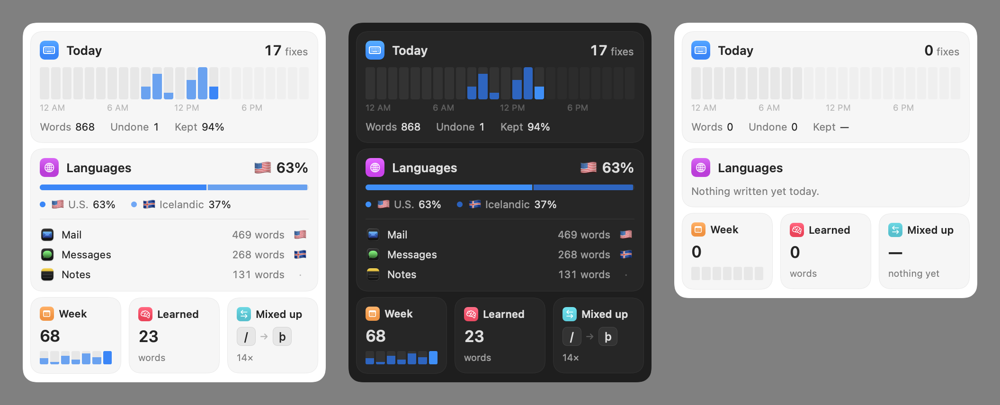

# Common Keys

[](https://github.com/oddurs/common-keys/actions/workflows/ci.yml)
[](LICENSE)

A menu bar app that fixes words typed on the wrong keyboard layout, for every keyboard macOS has. **[oddurs.github.io/common-tools/keys](https://oddurs.github.io/common-tools/keys/)** · [Docs](https://oddurs.github.io/common-tools/keys/docs/)



- Type `/etta ` on U.S. and it becomes `þetta `; `ghbdtn` becomes `привет`, `dkssud` becomes `안녕`.
- It learns which keys you mix up and which language you write in each app, and keeps you on the right one.
- ⌘Z right after a fix undoes it, and that word is left alone from then on.
- Double-tap right ⌥ converts the word before the cursor; ⌥⇧Space switches layout.
- Switching apps restores the layout you last used there, or the one you usually write in.
- It runs on **WorldKey**, an engine that reads keys on any keyboard. Other tools can use it through the `worldkey` command.

Free and open source under the MIT licence. No network access, and what it learns stays on your Mac.

## Install

Requires macOS 14.4 or later.

1. Download [CommonKeys.zip](https://github.com/oddurs/common-keys/releases/latest/download/CommonKeys.zip), unzip it, and move **Common Keys** to Applications.
2. Open it. The build is not notarized, so the first time macOS will say it can't verify the developer. Go to **System Settings › Privacy & Security** and click **Open Anyway**. Alternatively, run:

   ```sh
   xattr -dr com.apple.quarantine "/Applications/Common Keys.app"
   ```

3. Allow Common Keys in **System Settings › Privacy & Security › Accessibility** when it asks. It needs Accessibility to read key presses and type fixes back; it asks for nothing else.

Release builds are signed ad-hoc, so macOS treats each update as a new app. After updating, turn Common Keys off and on again in Accessibility, or remove it there and allow it again.

### The `worldkey` command

Download [worldkey.zip](https://github.com/oddurs/common-keys/releases/latest/download/worldkey.zip), unzip it, and put `worldkey` on your `PATH`:

```sh
unzip worldkey.zip
xattr -d com.apple.quarantine worldkey
mv worldkey /usr/local/bin/
```

## Usage

Common Keys lives in the menu bar as the flag of the current layout. The menu shows the day's words and fixes, your languages, the keys you mix up most, and the enabled keyboards to switch between.

- **Fixing as you type** happens when a word ends. **Pause Fixing** in the menu stops it; the convert shortcut still works.
- **Convert last word**: double-tap right ⌥ by default; Settings offers double-tap ⇧ or ⌃ instead, or off.
- **Next layout**: ⌥⇧Space by default, changeable in Settings.
- **Per-app layouts**: from the menu or Settings, pin the front app to one layout, or pause Common Keys in it. Terminals and code editors start paused.
- **Forget Everything…** in Settings clears what it has learned.
- **Settings** opens from the menu with ⌘, or by opening the app again while it runs. It has
  Shortcuts, Exceptions (per-app layouts), Learning, and General (**Open at login**), and ends with
  the Common Tools family and the app's version.

Learned data lives in `~/Library/Application Support/LangSmart/` (the folder keeps the app's former name):
`memory.json` holds learned words, mixed-up keys and each app's usual layout, and `stats.json` holds the
menu's daily counts for the last month, never the words themselves.

## WorldKey

The engine is a library, `WorldKey`, in layers. Each layer knows nothing of the ones above it.

1. **Keys.** A key press is a key code and modifiers, not a character, because the same key means
   a different letter on every keyboard.
2. **Keyboards.** Anything that turns keys into text conforms to `Keyboard`, in one of three kinds:
   - *direct*: every ordinary layout. `KeyLayout` reads the layout's own table with the system
     translator, so all 251 layouts in macOS 26 work, across 35+ scripts, dead keys included, and
     it can run backwards from text to keys.
   - *composing*: an input method whose output is predictable. A `Composer` assembles the layout's
     characters: `HangulComposer` for Korean 2-Set, `VietnameseComposer` for Telex and VNI. These
     are fixed in both directions.
   - *converting*: an input method whose output the user picks, such as Japanese or Chinese. Their
     text is never read back. They are only a destination: the engine hands them the keys and they
     compose as usual. `Phonotactics` recognizes romaji and pinyin readings.

   `InputSources` maps every macOS input source to one of these.
3. **Evidence.** Each reading of the keys is weighed by `Scorer`, using:
   - the system spell checker, where a word counts only if the dictionary lists it exactly, since
     some dictionaries accept any string;
   - `Orthography`: rules no word breaks, such as a Hebrew final letter mid-word, a word starting
     with a combining mark, or two scripts in one word;
   - the language recognizer, between readings in the same script only;
   - what the user taught (`Memory`).
4. **Decisions.** `Detector` compares the readings and decides at the end of a word, mid-word,
   or when asked. It also says which language a word was meant in, which feeds per-app learning.

Above the engine, the app adds the event tap, injection and UI. Swapping text depends on the kinds
involved. Between ordinary layouts the fix goes out right behind the triggering key. When an input
method is involved, the old text is erased first and the layout switched, then the new text is typed
or the keys replayed, because an input method would read typed Unicode as key presses.

### Using it from other tools

    worldkey sources [--all]
    worldkey convert ghbdtn --from US --to Russian # привет
    worldkey convert 안녕하세요 --from 2SetKorean --to US   # dkssudgktpdy
    worldkey detect /etta --from US                # þetta  com.apple.keylayout.Icelandic
    worldkey eval --keyboards US,Russian --words 150

Add `--json` for output another program can parse. The `WorldKey` library product is the same engine
for Swift code.

### How well it works

`worldkey eval` takes dictionary words, types each on its own keyboard and on the wrong one, and
counts the results. On macOS 26 with 150 words per language:

| Keyboards | Correct words changed | Fixed: English typed on the other / the other typed on U.S. |
|---|---|---|
| U.S. + Icelandic | 0 / 300 | Icelandic on U.S. 97% (others read the same) |
| U.S. + Russian | 0 / 300 | 98% / 100% |
| U.S. + Korean 2-Set | 0 / 300 | 100% / 100% |
| U.S. + Greek | 0 / 300 | 99% / 97% |
| U.S. + Hebrew | 0 / 300 | 93% / 97% |
| U.S. + Arabic | 0 / 300 | 88% / 98% |
| U.S. + French | 0 / 300 | 100% / 92% |
| U.S. + German | 0 / 300 | 97% / 82% |
| U.S. + Russian + Ukrainian | 0 / 450 | 81–100% |

The misses are mostly short words that are real in both languages, such as `an` and `αν`, or `do`
and `גם`, where leaving them alone is right. Judging a word takes about 0.13 ms.

### Limits

- Languages without a system dictionary, like Thai, Khmer or Georgian, rely on spelling rules and
  what you teach. Auto-fixing is cautious there, and the convert shortcut and learning carry it.
- Thai and other scripts written without spaces end a "word" only at a space.
- Text typed in a converting input method is never fixed: it is the user's pick.
- Korean 3-Set, romaja and shape-based Chinese methods are destinations for the convert shortcut
  only.

## Build from source

The Command Line Tools are enough; Xcode is not required.

```sh
scripts/dev-cert                          # once: a stable signing identity, see below
scripts/task build                        # universal build → build/Common Keys.app and build/worldkey
mv "build/Common Keys.app" /Applications/
```

`scripts/dev-cert` puts a self-signed "LangSmart Development" certificate in your login keychain, and
builds are signed with it. macOS ties the Accessibility grant to that certificate, so you allow
Common Keys once and it survives rebuilds. Without it, builds are signed ad-hoc and each one needs
the grant again.

## Development

```sh
scripts/setup           # once: wire the git hooks
scripts/agent doctor    # check tools and repository state
```

| Command | Does |
| --- | --- |
| `scripts/task check` | format check, lint, test, build: exactly what CI runs |
| `scripts/agent start <type>/<slug>` | new worktree and branch from `origin/main` |
| `scripts/agent commit "<type>: subject"` | Conventional Commit, checked by the hook |
| `scripts/agent pr` | full check, push, open the pull request |
| `scripts/agent sync` | rebase onto `origin/main` |
| `scripts/agent done` | after merge: remove the worktree and branch |
| `scripts/agent list` | worktrees, branches, and pull request state |

See [CONTRIBUTING.md](CONTRIBUTING.md) for the workflow.

`swift build && .build/debug/LangSmart --snapshot out.png` renders the menu's cards in light and dark
without opening the menu. `swift scripts/make-icon.swift` redraws the app icon.

Layout:

- `Sources/WorldKey`: the engine. Keys, keyboards, evidence and decisions, with no UI state.
- `Sources/LangSmart`: the app: event tap and injection, status item and menu, Settings. The target
  keeps the app's former name.
- `Sources/WorldKeyCLI`: the `worldkey` command.
- `Tests/WorldKeyTests`: unit tests, plus system and accuracy tests against the layouts and
  dictionaries installed on the Mac.

## Licence

MIT. See [LICENSE](LICENSE).
